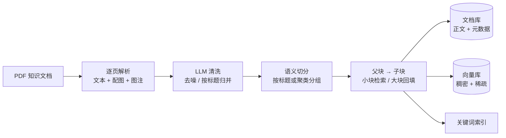
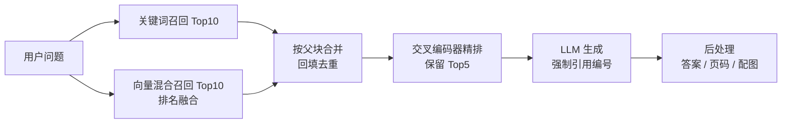

<div align="center">

# 企业知识库 RAG 问答

**让答案准、让出处点得开、让专业名词不靠猜。**

设计说明 · 不含源码

</div>

---

## 关于这份文档

这里记录的是这套问答系统的**设计思路与取舍**，不包含实现代码与语料。

写这份文档的原因：企业知识库问答真正的难点不在"能不能聊"，而在于三件事必须同时成立——
**答案要准**（条款号不能对错）、**出处能核**（点得开、看得见原文）、**术语要懂**（不能答得像百科）。
这三件事各自都有成熟解法，难的是它们会互相拉扯。

下面每条结论都对应一个具体的失败案例，不是从论文里抄的结构。

---

## 一、五个真实困难

| 实际困难 | 常见失败方式 | 应对方向 |
|---|---|---|
| 制度条款写法固定、术语密集（"差旅住宿标准""审批权限"） | 纯向量检索把同义条款混在一起，条款号对不上 | 关键词召回不能被向量替代，两路并行 |
| 一个条款被切碎后语义残缺 | 按长度切块，答案正好被切在边界上 | 先按语义分段，再在段内切片；检索小块、回答大块 |
| 用户一句话，文档里对应三五个段落 | Top-K 直接喂给 LLM，噪声淹没有效信息 | 精排后再压缩到个位数 |
| 答案无法核实 | 模型自由发挥，编造条款 | 强制引用标注，后处理解析成页码与原文配图 |
| 通用模型不懂企业术语 | 直接调通用 API，答得像百科 | 用检索结果反向构造训练数据，微调后本地部署 |

---

## 二、核心设计

### 2.1 混合召回：关键词与向量各管一半

两路召回各取 Top-10，**互不替代**：

- **关键词路（BM25）**：中文分词 + 停用词过滤。负责命中罕见术语、编号、专有名词——
  这类词恰恰是向量检索最容易失效的地方："语义相近但没命中"在制度问答里等于答错。
- **向量路（稠密 + 稀疏混合）**：同一个模型同时产出稠密向量与稀疏向量，用倒数排名融合。
  稠密负责语义泛化，稀疏负责词面覆盖，比单路稠密稳定。

两路结果按**父块 ID** 合并去重。这一步是设计上的关键：
**只要某个子块被命中，就把它的父块整段取回来**，避免上下文被切断。

一个容易踩的坑：融合算法传权重是无效的——倒数排名融合本身就是无参数的。想要加权融合，
得换用带权重的融合器，否则那两个系数只是装饰。

### 2.2 父子块 + 语义切分：先按意思分段，再按长度切片

建库时的切分顺序是"**先语义、后长度**"：

```
逐页抽取（文本 + 配图 + 图注）
  → LLM 清洗（去硬换行、按标题归并、标题转 Markdown 三级标题）
  → 句子切分 → 句向量 → 层次聚类（余弦 / 平均链接）
  → 语义分组即"父块"（目标每组 10 句左右）
  → 父块内按 token 数切"子块"（256 token / 重叠 50）
```

三个细节决定了效果：

- **标题优先于聚类**：清洗阶段已把标题转成 Markdown 三级标题。切分时一旦发现文本里有标题标记，
  **直接按标题断章，不再做聚类**。制度类文档的章节边界比聚类结果可靠得多——
  聚类是统计意义上的"意思相近"，而标题是作者给出的权威分界。
- **父块有长度上限**（512 字符）。超长的父块不进检索集，否则"召回一个两千字的章节"等于没召回；
  但它仍然入库供回填使用。**检索集和回填集是两个不同的集合**，这一点必须分开设计。
- **语义切分独立成一个服务**，用小模型做句向量，避免和检索用的大模型抢显存。
  这是很朴素的资源隔离：切分是离线批处理，问答是在线低延迟，两者对显存的需求形态完全不同。

### 2.3 精排：小模型做最后一道筛

两路召回融合去重后可能还有十几条，交给微调过的交叉编码器逐对打分，保留 Top-5 作为生成上下文。

这里有个反复验证过的结论：**精心设计的召回不如一个训练过的精排**。
召回阶段追求的是"不漏"，精排追求的是"排序对"——两者的优化目标不同，用同一个模型兼顾效果通常都不好。

另一个工程细节：精排模型只在推理时用 fp16、其余阶段用 fp32 会带来数值不一致，
线上线下的分数对不上时，先查这里。

### 2.4 可溯源：从引用编号一路还原到原文配图

生成提示词强制模型按 `{答案}【引用编号】` 的格式标注引用，后处理负责拆解成三样东西：

```
答案（去掉引用标记）
引用页码（去重升序）
引用块所在页的配图及其标题
```

**配图不是按页截的**。在 PDF 解析阶段就要为每张图找"标题块"：在图片上方的扩展区域里搜索文本块，
按字号、是否加粗、行数、长度、是否位于图片上方综合打分，超过阈值才认定为图注。
这样"图 3-2 报销流程图"这类图注才会随答案一起返回，而不是把整页截图丢给用户。

尺寸过小的图标（如 ≤34px）和装饰性 PNG 在解析阶段直接跳过——这一条能砍掉大量无效配图。

### 2.5 领域微调：用检索结果反向造训练数据

一条脚本产出两份训练集，都来自**同一批真实检索结果**：

- **生成模型（SFT）**：对每个训练问题跑完整链路，把「query + 精排上下文」作为输入、
  把模型自己带引用的回答规整成标准格式作为输出。
  **引用为空的样本不丢弃，而是标为"无答案"**——这本身就是拒答样本，比只喂正例更能压住幻觉。
- **精排模型（三档标注）**：同一条 query 下，第一名的上下文标 2，末尾两条之一标 1，
  未入选的召回结果标 0。三档而不是两档，是为了让精排学到"部分相关"这一档——
  非 0 即 1 的二分类会逼模型把"沾边"和"完全无关"混为一谈。

生成模型用中等规模底座做 LoRA 微调，合并量化后由推理框架本地服务，
解码温度压到极低、加频率惩罚，保证同一问题答案稳定、不跑题。
**企业问答里，"每次答得不一样"本身就是缺陷**。

### 2.6 评测：两条口径并行

同时给两套分数，因为它们回答的是不同问题：

- **语义 + 关键词加权**：`0.8 × 语义相似度 + 0.2 × 关键词命中`。
  关键词用 Jaccard 命中率、设阈值折算为 0/1，避免长答案被稀释；标为"无答案"的样本单独判定对错。
  **加权而非纯语义，是因为纯语义对"意思对但条款说错"完全不敏感**——而这恰恰是企业问答里最严重的一类错。
- **RAGas 口径**：上下文召回率 + 上下文精确率，衡量召回本身的覆盖度与信噪比，
  把"检索不行"和"生成不行"分开定位。

两套分数都低于 0.6 的样本打印出来，人看几条就能判断该调召回还是调提示词。
这个阈值不是精确刻度，是**分诊工具**。

---

## 三、系统架构

离线建库：



在线问答：



---

## 四、数据准备的经验

这套管道对语料是有要求的，条件不满足时效果会明显劣化：

- **单一领域的连续型文档**最合适：制度汇编、产品手册、运维规范，单份 100–500 页效果最好。
- **多份不相关文档直接拼成一个 PDF 会让语义切分失效**——切分依赖标题层级，混装语料必须分库建集合。
  这是硬约束，不是建议。
- 清洗质量直接传导到切分质量。清洗依赖 LLM，页数多时成本可观，**建议先用十页样本验证再全量跑**。

---

## 五、已知边界

- **单文档建库**。默认指向单个文件，多文档场景需要改成目录遍历，并为每份文档补来源元数据以便区分出处。
- **向量库用的是本地文件模式**，适合单机验证；数据量上万条后需要切到独立服务并调索引参数。
- **配图元数据只挂在文档上**，没有独立管理，图片散落在本地目录，要独立检索需要补写入逻辑。
- **查询改写默认关闭**。实测在条款型问题上，假设式改写（HyDE）会引入虚构表述，
  只在口语化长问题上有收益。开启前建议先做 A/B——**这类技巧的收益高度依赖问题形态，不能默认开**。
- **清洗成本与效果强相关**。并发清洗在页数多时费用可观，且清洗质量差会直接毁掉后续所有环节。

---

## 六、如果重做一次

1. **把评测放到最前面**。现在两套口径都是补上的。企业问答真正该先定的是"什么叫答对了"——
   是条款号对，还是意思对？这两个标准会导出完全不同的召回策略。
2. **父子块的比例应该自适应**。现在父块按固定句数分组、长度上限是拍的。
   更好的做法是按章节的自然长度决定，短章节不强行合并。
3. **配图检索应该独立成一路**。现在配图是跟着文本块走的，
   但"这张流程图讲什么"和"这段文字讲什么"是两个不同的检索需求。

---

## 七、说明

- 本文只描述设计，**不包含语料、不包含权重、不包含实现代码**。
- 文中出现的制度条文、术语示例（如"差旅住宿标准"）均为虚构的演示文本，不代表任何真实机构的规定。
- 精排模型的训练方法参考了开源项目 **RAG-Retrieval**（NLPJCL，MIT 许可），
  相关方法论归属原作者，本文仅记录在其基础上的使用方式。
